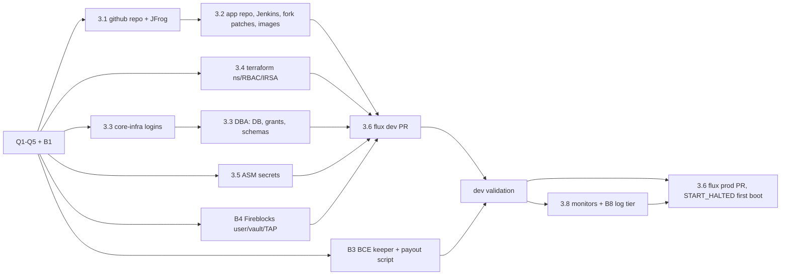

# Plan: deploy the Aave v4 arbitrageur (Ponder indexer + bot) to on-chain-trading

## Update 2026-11-16: user decisions + new findings (supersedes conflicting text below)

Decisions (user):
- **Interim TS bot.** The Rust port is a parallel learning project; a Ponder-style indexer stays. Q2 is closed.
- **Images build from `GalaxyDigitalLLC/on-chain-trading-projects`** (Q3 closed by the user).
  - Vendor the code to `projects/aave-arbitrageur/upstream/`: the pristine v0.4.2 tree (no `lib/`, `.github/`, `node_modules`) as commit 1, then the Fireblocks commit as commit 2.
  - Record provenance in `UPSTREAM.md` and keep `LICENSE`.
  - Update `references/README.md` to note the exception.
  - The JFrog repo already exists: `gdllc-on-chain-trading-projects-container-low-l` (`infra/github/.../repos.yaml:50-56`). Images are `aave-arbitrageur-indexer` and `aave-arbitrageur-bot`, tagged `<sha7>` (`<sha7>-rc` on PRs). **§3.1 (new org repo) is dropped.**
  - The **root `Jenkinsfile-platform` builds nothing today**: it only detects changed projects and checks that a project Jenkinsfile exists. It must be changed to dispatch (CODEOWNERS-protected). Options: a `load` of a scripted project Jenkinsfile, or a `when`-guarded build stage. Ask DevEx how project jobs are wired.
  - v0.4.2 needs Node ≥ 22.15 and pnpm 10.34.9 (Dockerfiles already updated; the Jenkins `node` image must match).
- **Fireblocks is one code path, selected by config.** Verified on the fork: no hardcoded adapter host, no env-specific branching. UAT vs prod differ only by `FIREBLOCKS_BASE_URL`, the apikey secret, `FIREBLOCKS_VAULT_ACCOUNT_ID` and `FIREBLOCKS_ASSET_ID` (`ETH_TEST5`/`ETH`).
  - Dev uses the UAT adapter (no ingress allowlist; reachability from gdtcore-use1-dev is still untested).
  - UAT's Fireblocks upstream is also `api.fireblocks.io`, so testnet support depends on the UAT API user's workspace having `ETH_TEST5`.
- **Sepolia first, mainnet later.** The infra team runs `vaultd`. Testnet wallets: Signet `tb1qv0k…`, Sepolia EOA `0x892f…2c29`.

Source:
- Local branch `feat/fireblocks-execution-v0.4.2` @ `1c969ff` (Fireblocks commit replayed cleanly on v0.4.2 `1a73df8`). Not pushed.
- The commit touches no `package.json` or lockfile.
- v0.4.0→v0.4.2 changed no ABIs, env vars or Ponder schema; it moves deps to zod 4, vitest 4 and pnpm 10, so re-run the typecheck and tests on the Fireblocks code.
- v0.4.3 (`bfa132e`, "bump contracts to v1.x") also exists. Pick the tag that matches the deployed contracts.

**⛔ New P0: on-chain probe, Sepolia block 12,150,096 (via `curl` JSON-RPC to publicnode):**

| Proxy | `WBTC()` | `EXIT_BTC()` | `pauseState()` | implementation (EIP-1967) |
|---|---|---|---|---|
| `0xCaf3DE0ec631e2DEB3b4A33679037488B545f5a2` (Babylon docs' address) | `0x5045…4054` | **reverts** | **2 = Paused** | `0xa3fe…8f46` |
| `0xf5Be2Cc13EDbDcf37e3f4239b46dbCeb21C132e7` | `0x5045…4054` | **reverts** | **1 = Frozen** | `0xd2ff…c4f6` |

- Both known Sepolia BTCVaultSwap deployments still expose the **old `WBTC()` ABI**. v0.4.2's bot uses `EXIT_BTC()` / `swapExitBtcForVault`, so it would not work against either.
- Babylon's "use v0.4.2" implies a newer Sepolia deployment at an address we don't have. **Ask Babylon for the current Sepolia (and mainnet) BTCVaultSwap address, its deploy block, and the matching bot tag (v0.4.2 vs v0.4.3).** Re-run this probe on the address they give.
- No Galaxy keeper is in Babylon's published Sepolia keeper list (RockX, Babylon 0/1).

Still open:
1. The address above.
2. The roles of the Sepolia EOA and the Signet wallet. Neither is documented: is the EOA the keeper's roster address or the bot's executor? Is the Signet wallet the payout script?
3. The keeper roster ETH address from the infra team, for `VAULT_KEEPER_ADDRESS`.
4. UAT Fireblocks: `ETH_TEST5` support, a new API user/apikey, a vault, and the TAP policy.
5. DevEx: Jenkins dispatch for monorepo projects.

Status: v2. This is research only and nothing has been edited. v1 was corrected by 4 adversarial reviews.
- Evidence: `local://research/*.md` (9 reports) and `local://review/*.md` (4 reviews).
- Source tree: `on-chain-trading-projects/references/aave-v4-bots` @ `71621cf` (fork `vishalrachapudi404/aave-v4-bots`, branch `feat/fireblocks-execution`).

## 0. Go/no-go questions (answer before any PR)

| # | Question | Why it gates everything | Evidence |
|---|---|---|---|
| Q1 | **Which BTCVaultSwap version is deployed on Sepolia and mainnet?** | The bot ABI uses the post-#629 names `swapExitBtcForVault[OnBehalf]` and `EXIT_BTC()`, and an 8-field preview without `amountFee`. Sepolia was checked on chain on 2026-09-30 and still had `swapWbtcForVault` and `amountFee`, so the indexer preview and every swap would fail. Check with `cast call <VaultSwap> "EXIT_BTC()(address)"` plus a selector check for `0x3e2cd070`. | `packages/abis/src/vaultSwap.ts:10,24,48,61-65`; `lib/tbv-contracts/CHANGELOG.md:117-118`; `projects/tbv-arbitrageur/docs/plans/rust-arbitrageur-bot-implementation-plan.md` "Deployed Testnet Contracts" |
| Q2 | **Is the TS fork the interim bot until the Rust port (`projects/tbv-arbitrageur`) ships?** | The Rust plan says Galaxy builds its own "rather than using the reference implementation". It uses no Ponder, its own Fireblocks client and a claim-tracker. Deploying the TS bot means a second bot in a new repo; half the infra here (indexer, its DB, schema ops) is Ponder-only. Write down a decision record and an exit criterion. | Rust plan "Context"; `projects/tbv-arbitrageur/README.md` "Status": only `tbv-domain` exists |
| Q3 | **Can we host Babylon's private code in a Galaxy org repo?** The MIT LICENSE says yes, but the upstream repo is private. The Fireblocks commit was written on a personal account. | Jenkins only builds GalaxyDigitalLLC repos. Without this there are no images. | `references/README.md:3-5`; LICENSE |
| Q4 | **Sepolia is Frozen (`pauseState()==1` on 2026-09-30). Is there a path to a test vault?** | Without one, dev never performs an acquisition. Prod would be the first live run of the Fireblocks path, which README says has run "against a local fake… not a live workspace". | Rust plan "Open Questions"; `README.md` FIREBLOCKS limits |
| Q5 | **Execution mode** (my recommendation: prod `FIREBLOCKS`/`galaxy` + `inventory`) | Decides secrets, TAP, IAM and egress | §1 D3 |

If Q1 says "old ABI", the fork needs an ABI patch or Babylon upgrades Sepolia. If Q2 says "Rust only", stop here: this plan becomes the infra template for the Rust bot minus Ponder.

## 1. Decisions baked in (override any)

| # | Decision | Choice | Why / evidence |
|---|---|---|---|
| D1 | Namespace | `aave-arbitrageur` in both clusters. **Terraform owns it**, with PSA and istio labels set in `kubernetes_namespace.metadata.labels`. **No flux `namespace.yaml`.** | With flux `prune: true`, removing a flux Namespace later deletes the namespace. arbby is TF-only. The TF Role/RoleBinding needs the namespace first. |
| D2 | Releases | `aave-arbitrageur-indexer`, `aave-arbitrageur-bot` | The chart gives one image per HelmRelease. Container, Deployment, Service and `app.kubernetes.io/name` all equal the release name (`_names.tpl:3-5,27-29`). |
| D3 | Execution | **prod: `FIREBLOCKS` + `galaxy` backend.** dev: `FIREBLOCKS` via the UAT adapter if that workspace has `ETH_TEST5`, else `AUTO` + a dedicated testnet key from ASM with `SIGNER_ADDRESS` set. | arbby/trading-arbby already sign through the prod adapter from gdtcore-use1-prod, and the adapter allowlists the prod EKS CIDRs. No KMS signer exists anywhere in infra. |
| D4 | Funding | `inventory` | Router funding needs a local key, so FIREBLOCKS can't use it (`funding/index.ts:25`). |
| D5 | Liquidation engine | off | Turning it on later means a new indexer schema and a full backfill. |
| D6 | Secrets | ESO only. IRSA ServiceAccounts are used **only by the SecretStores**. Pods run as separate un-annotated SAs with `automountServiceAccountToken: false` (kuration `workload-serviceaccounts.yaml`). Bot uses `SECRETS_PROVIDER=env`, with `*_REF` set to env var names. | The bot cannot read `CLIENT_RPC_URL`/`DATABASE_URL` from ASM. Keeping IRSA off the pods keeps ASM credentials out of the untrusted indexer. |
| D7 | DB | New database `arbitrageur` on the existing Aurora PG 17.4 clusters. Password auth for both roles. **Rotation disabled for both logins until Reloader is deployed fleet-wide.** | Reloader is not installed on gdtcore; the existing annotations do nothing (`kuration/api/helmrelease.yaml:123-127`). Both apps build their pg pool once at boot. Alternative: indexer `DB_AUTH=iam` (supported in `services/ponder/src/dbAuth.ts`). |
| D8 | Images | JFrog `galaxydigital.jfrog.io/gdllc-<repo>-container-low-l/{indexer,bot}:<sha7>`, built by Jenkins in a new org repo seeded from `71621cf` | The flux PR check rejects ECR images and images not in JFrog. Nodes are amd64 (m6a, AL2023 x86_64). |
| D9 | Chain | dev = Sepolia 11155111; prod = mainnet 1 | user |
| D10 | Single writer | Both releases: `strategy: Recreate` and **both** `replicaCount: 1` and `autoscaling {minReplicas: 1, maxReplicas: 1}` | Chart 1.1.6 replica semantics can't be verified from the repo and the repo usage is mixed. Setting both is safe under 1.1.6 and 2.0.0. |

## 2. External prerequisites (owners outside the team)

| # | Item | Owner | Blocks |
|---|---|---|---|
| B1 | Q1–Q4 answered | Babylon / user / legal | everything |
| B2 | Contract inputs: mainnet `VAULT_SWAP_ADDRESS`, `WBTC_ADDRESS` and deploy block. Sepolia: confirm VaultSwap `0xf5Be2Cc13EDbDcf37e3f4239b46dbCeb21C132e7`, WBTC `0x504579d0424b7b7cb4b17e16626f6a2f67bca054` and the deploy block. **Implementation addresses and the AccessManager upgrade delay.** | Babylon | indexer, code-hash pin |
| B3 | **Vault keeper = BCE workstream.** `vaultd` in vault-keeper mode comes from Babylon's private `btc-vault` repo and is not in this repo. It needs 12 cores / 16 GB / 2 TB, Bitcoin Core with txindex, an SP1 prover, its own Postgres, and public 8080/8081/50051 behind self-hosted TLS. Babylon registers the keeper; BCE generates the AVK keys. We need: the keeper's roster ETH address for `VAULT_KEEPER_ADDRESS`, and the payout script pointed at a Fireblocks BTC address (`vaultd vk set-payout-script`). | BCE + Babylon | any acquisition. A missing keeper is not caught at boot; the first swap reverts with `UnauthorizedVaultKeeper`. |
| B4 | Fireblocks (Custody/Ops): a **dedicated** API user and internal apikey (do not reuse arbby's), a new vault account (ETH + WBTC), and TAP rules in first-match order (below). Do **not** add our prefix to `AUTO_APPROVE_APIKEY_PREFIXES`: the co-signer's txId/calldata match is a real control. Dev: confirm the UAT adapter workspace has `ETH_TEST5` and that `gdtcore-use1-dev` reaches `*.uat-gp.galaxydigital.io`. | Custody | bot execution |
| B5 | RPC URLs in ASM (§3.5), plus the **hostnames** for the Cilium FQDN allowlist | user | both |
| B6 | DBA (as `postgres`/`sa`): create the DB, grant DB-level privileges, pre-create the schemas (§3.3). Neither core-infra nor flyway can do this: there is no `postgresql_database` anywhere, `terraform_create_user` only has CREATEROLE, and flyway runs in `trading` inside a transaction. | SRE/DBA | §3.3 |
| B7 | Desk: `BTC_REDEMPTION_COST_SATS` (source: BCE's `vaultd` fee data), `RISK_MIN_PROFIT`, WBTC working capital (kept small because of the max approve), the BTC→WBTC capital loop (about 3 days locked per vault), `POLLING_INTERVAL_MS`, `RISK_MAX_IN_FLIGHT` | desk + BCE | prod config |
| B8 | SRE: add `aave-arbitrageur` to the prod `@tier` clause (`datadog-config/resources/sre/log-pipelines/main.tf:454-460`). Otherwise prod logs are nonprod with 3-day retention. | SRE | prod |
| B9 | Operator list for the prod RoleBinding (today only 2 named users can port-forward) | user | kill switch |
| B10 | Jira ticket (flux `.omp/AGENTS.md` wants `plans/<TICKET>-<slug>.md`) | user | PRs |
| B11 | **Human, out of PR scope:** wallet and key creation, key import into ASM, and funding of the dev signer and the Fireblocks vaults. Follow the `hot-wallet` skill: share addresses only, never put key material in files, tickets or chat. | user/Custody | funding |

TAP (B4), first match:
- R1: initiator = our API user, source = our vault, CONTRACT_CALL to whitelisted contracts BTCVaultSwap (`swapExitBtcForVaultOnBehalf`) and WBTC (`approve`, including `approve(…,0)` for the halt-time revoke). Allow.
- R2: same initiator, anything else. Block.
- Audit for wildcard-initiator rules above R2.
- **Unverified:** the bot sends `destination.type = ONE_TIME_ADDRESS` (`custody/fireblocks.ts:227-229`). Custody must test in UAT that OTA destinations match whitelisted-contract method rules. If they don't, TAP cannot pin the contracts, and the fork must send a whitelisted-contract destination id instead.

## 3. Work by repo

Dependency order: §3.1 → §3.2 → images; §3.3 and §3.4 in parallel; §3.5 manual; §3.6 last.

### 3.1 `infra/github`: org repo and JFrog
- `GalaxyDigitalLLC/repos/on-chain-trading/repos.yaml`: new repo (e.g. `on-chain-trading-aave-arbitrageur`) with `artifactory: {enabled: true, kinds: [{kind: container}]}`.
- `teams/onchain-trading/teams.yaml`: add the repo.
- Atlantis apply creates the repo, the JFrog repo `gdllc-<name>-container-low-l`, and the Jenkins push credential.

### 3.2 New app repo (fresh history from `71621cf`)
- Leave out `lib/` submodules (private Babylon) and `.github/workflows` (Babylon secrets). Keep `LICENSE`.
- `Jenkinsfile-platform` modelled on `on-chain-trading-web`:
  - stage `pnpm install --frozen-lockfile && pnpm check && pnpm test`, in a `node:22` container; suites that need `lib/tbv-contracts` self-skip.
  - build images `indexer` (`docker/ponder.Dockerfile`) and `bot` (`docker/arbitrageur.Dockerfile`), context `.`.
  - tags `<sha7>`, plus `<sha7>-rc` on PRs; `glxy-artifact-lib@v1.7.1`.
- Zscaler: base image from `galaxydigital.jfrog.io/library/node:22-alpine` and/or add the Zscaler CA (curator precedent). The `apk add wget=~1.25` pin is fragile.
- Fork patches, each with a risk accepted if not done:
  - (a) **Code-hash guard reads the EIP-1967 implementation slot.** Today `getCode(proxy)` doesn't change on an upgrade, so pinning the proxy only catches selfdestruct or a wrong address (`chain/src/queries.ts:29-34`, `risk/src/gate.ts`).
  - (b) `approve(required)` instead of `maxUint256` (`fireblocksExecutor.ts:252-262`). TAP cannot cap amounts.
  - (c) Fail boot when the RPC chain id ≠ an expected `CHAIN_ID` (there is no such guard today).
  - (d) The ABI fix if Q1 requires it.
  - (e) Optional: JSON logs (the logger is plain `console.*`).

### 3.3 Database (DBA + core-infra)
- core-infra `gdt-core/us-east-1/lambda/on-chain-trading/{dev,prod}.tf`: 2 login modules each, copying the collector module.
  - logins `arbitrageur_bot` and `arbitrageur_indexer`.
  - **`dbname = "postgres"`**, like every existing login; `/arbitrageur` goes in the ESO URL template. `dbname="arbitrageur"` would break single-user rotation.
  - rotation disabled (D7).
  - `function_name` ≤ 46 chars, e.g. `arbitrageur_indexer_on_chn_trad_prod-rotation` (45).
  - `statement_timeout` on the bot login.
  - Expect a rebase against worktree `OCT-121-prod-curator-login`.
- DBA SQL, run once per cluster **after the logins exist and before any pod starts**:
  ```sql
  CREATE DATABASE arbitrageur OWNER sa;
  REVOKE ALL ON DATABASE arbitrageur FROM PUBLIC;
  GRANT CONNECT, CREATE ON DATABASE arbitrageur TO arbitrageur_bot, arbitrageur_indexer;
  \c arbitrageur
  REVOKE ALL ON SCHEMA public FROM PUBLIC;
  CREATE SCHEMA bot AUTHORIZATION arbitrageur_bot;               -- stops the indexer from squatting it
  CREATE SCHEMA ponder_sync AUTHORIZATION arbitrageur_indexer;   -- stops the bot from squatting it
  ```
  - `CREATE ON DATABASE` is **permanent for both roles**. PG17 `CreateSchemaCommand` checks the database ACL before the `IF NOT EXISTS` skip, and the bot runs `CREATE SCHEMA IF NOT EXISTS bot` on every boot (`persistence/src/postgres.ts:140`).
  - Gate: `\dn+` shows the owners above; `\du` shows no cross-membership and no `rds_superuser`.
- Flyway: **no change.** The `on-chain-trading*` modules target `trading`. A new flyway module would need new Jenkins credentials, and the dev flyway credential already looks missing in `infra/jenkins`.
- Ops:
  - `ponder_<hash>` cleanup after every indexer upgrade: keep current and previous; never drop `ponder_sync`. pg_cron is bound to `trading`, so this is a runbook step.
  - Add a database-size monitor.

### 3.4 `infra/terraform`: namespace, RBAC, IRSA
- `gdt-core/us-east-1/eks/rbac/rbac_on_chain_trading_aave_arbitrageur.tf`:
  - `kubernetes_namespace` with labels: PSA enforce `baseline`, warn/audit `restricted`, `istio-injection: disabled`.
  - Role and RoleBinding for `local.aave_arbitrageur_team` (B9).
  - **Do not clone arbby's prod Role.** It grants get/delete on `*`, which includes Secrets and CNPs, plus Job create, and a Job could mount the bot Secret and the IRSA SA.
  - Prod Role, explicit list:
    - get/list/watch on pods, pods/log, events, deployments, replicasets, configmaps, services, helmreleases, externalsecrets
    - `pods/portforward` create
    - delete on pods
    - no secrets, no exec, no job/pod create
  - Non-prod: existing `*` practice is acceptable because dev holds testnet value only.
- `gdt-core/us-east-1/eks/assumed-roles/on-chain-trading-aave-arbitrageur.tf`: 3 ESO-only roles (role = policy = SA name; trust `system:serviceaccount:aave-arbitrageur:<sa>`; account 637423484532):
  - `aave-arbitrageur-indexer-secrets-${ws}`: `${ws}/on-chain-trading/aave-arbitrageur/indexer-*` plus the indexer DB login secret `…/arbitrageur_indexer-*`.
  - `aave-arbitrageur-bot-secrets-${ws}`: `…/aave-arbitrageur/bot-*` plus `…/arbitrageur_bot-*`.
  - `aave-arbitrageur-control-secrets-${ws}`: `…/aave-arbitrageur/control-*` (kill-switch token only).
  - DB login secret prefixes: `on_chain_trading_eng/dev/on_chain_trading/…` and `data_eng/prod/on_chain_trading/…`.
- KMS only if D3 changes to AUTO+KMS. It would be a new pattern and needs a security review.
- Apply both workspaces **before** the flux PR. Flux `apps` is one Kustomization per cluster, so a broken `aave-arbitrageur` dir blocks kuration and arbby reconciles.

### 3.5 ASM secrets (manual, per `dev|prod`; values never in git)

| Secret id | Keys | Read by |
|---|---|---|
| `<ws>/on-chain-trading/aave-arbitrageur/indexer` | `PONDER_RPC_URL` | indexer SecretStore |
| `<ws>/on-chain-trading/aave-arbitrageur/bot` | `CLIENT_RPC_URL`, `FIREBLOCKS_ADAPTER_API_KEY` (or dev-only `ARBITRAGEUR_PRIVATE_KEY`), `SLACK_WEBHOOK_URL` | bot SecretStore |
| `<ws>/on-chain-trading/aave-arbitrageur/control` | `RISK_CONTROL_TOKEN` | bot (control) SecretStore. Operators get the token from ASM, not from k8s. |
| core-infra login secrets | `username,password,host,port` | ESO templates for `DATABASE_URL` |

### 3.6 `infra/on-chain-trading-flux` (dev PR first, which is auto-approved; prod PR needs a human)
```
apps/gdtcore/gdtcore-use1-<env>/kustomization.yaml              # + - aave-arbitrageur
apps/gdtcore/gdtcore-use1-<env>/aave-arbitrageur/
  kustomization.yaml                                             # namespace: aave-arbitrageur
  base/{kustomization,serviceaccount,workload-serviceaccounts,secret-store,quota}.yaml
  indexer/{kustomization,helmrelease,external-secret,network-policy}.yaml
  bot/{kustomization,helmrelease,external-secret-config,external-secret-db,external-secret-control,network-policy}.yaml
```
- **Common values:**
  - chart `deployment` 1.1.6 from `glxy-charts`; `environmentName` set explicitly (it defaults to `dev`)
  - `datadogTags {team: on-chain-trading, project: <release>}`
  - D10 replica settings
  - `serviceAccount {create: false, name: <runtime SA>}`
  - `podSecurityContext {runAsNonRoot, runAsUser/Group 1001, seccomp RuntimeDefault}`
  - `securityContext {readOnlyRootFilesystem, allowPrivilegeEscalation false, drop ALL}`
  - emptyDir `/tmp`
  - ExternalSecret `v1beta1`, `refreshInterval: 1h`
- **Indexer:**
  - port `http` 42070
  - env: `PONDER_PORT=42070`, `CHAIN_ID`, `VAULT_SWAP_ADDRESS`, `START_BLOCK` (deploy block, never 0), `PONDER_TELEMETRY_DISABLED=1`; `DATABASE_SCHEMA` unset
  - `command: ["/bin/sh","-c","export DATABASE_SCHEMA=$(node scripts/indexerSchema.mjs) && exec node_modules/.bin/ponder start --port 42070 --log-format json"]`, which is `start.sh` plus JSON logs
  - emptyDirs `/app/services/ponder/.ponder` (Vite cache) and `/app/services/ponder/generated`
  - probes: **startup `/health`** (generous), readiness `/ready`, liveness `/health`
  - `DATABASE_URL=postgresql://{{user|urlquery}}:{{pw|urlquery}}@{{host}}:{{port}}/arbitrageur?sslmode=verify-full&sslrootcert=/app/services/ponder/certs/rds-global-bundle.pem`
- **Bot:**
  - port `metrics` 9091. The kill switch stays on `127.0.0.1:9095`: not in `service.ports`, reached only by `kubectl port-forward`, which dials the pod's loopback (prod has no `pods/exec`).
  - probes:
    - startup `/health` (period 5, failureThreshold ≥ 36): the server starts after bootstrap (RPC, risk runtime, Fireblocks check) and before the indexer wait.
    - liveness `/health`, lenient (period 30, failureThreshold 6). It is 503 only when both RPC and indexer are down, and **a restart clears an in-memory halt**.
    - readiness `/ready`.
  - openmetrics annotation `ad.datadoghq.com/aave-arbitrageur-bot.checks` with an explicit metric list.
  - Bot DB TLS: the RDS CA is not in the bot image. Mount the CA bundle from a ConfigMap and use `verify-full&sslrootcert=`; `sslmode=require` is unverified with node-pg.
- **Network policies (CiliumNetworkPolicy):**
  - indexer:
    - ingress 42070 **only from** `app.kubernetes.io/name: aave-arbitrageur-bot` in this namespace.
    - **no `host/remote-node`**: those identities cover every hostNetwork pod (ESO, nginx-private, lb-controller, metrics-server). Kubelet probes pass via allow-localhost; confirm with Hubble.
    - egress: DNS (kube-dns, `matchPattern "*"`), RDS writer FQDN 5432, RPC FQDNs 443.
  - bot:
    - ingress 9091 **only from the Datadog agent pods** (`k8s:io.kubernetes.pod.namespace: datadog` plus the agent label, verified with Hubble). The agent is not hostNetwork.
    - egress: DNS, RDS 5432, indexer 42070, RPC FQDNs 443, adapter FQDN 443 (`fireblocks-adapter-v2-core-systems.{prod,uat}-gp.galaxydigital.io`), `hooks.slack.com` 443.
  - RDS FQDNs: `on-chain-trading-{dev,prod}.cluster-c94s6km643eh.us-east-1.rds.amazonaws.com`.
- `base/quota.yaml` is sized from requests: indexer 250m/512Mi → 1/1Gi, bot 250m/256Mi → 500m/512Mi. Prod has 1 worker node by default, so a drain evicts the signer.

### 3.7 Bot runtime config

| Var | dev | prod |
|---|---|---|
| `EXECUTION_MODE` | `FIREBLOCKS` (or `AUTO` + `SIGNER_ADDRESS`) | `FIREBLOCKS` |
| `FIREBLOCKS_BACKEND` / `FIREBLOCKS_BASE_URL` | `galaxy` / `https://fireblocks-adapter-v2-core-systems.uat-gp.galaxydigital.io` | `galaxy` / `https://fireblocks-adapter-v2-core-systems.prod-gp.galaxydigital.io` |
| `FIREBLOCKS_API_KEY_REF` | `FIREBLOCKS_ADAPTER_API_KEY` (`FIREBLOCKS_SECRET_KEY_REF` must be **unset**) | same |
| `FIREBLOCKS_VAULT_ACCOUNT_ID` / `FIREBLOCKS_ASSET_ID` / `FIREBLOCKS_VAULT_ADDRESS` | new vault / `ETH_TEST5` / address (optional boot check; set it) | new vault / `ETH` / address |
| `FIREBLOCKS_POLL_TIMEOUT_MS` | ≥ TAP approval latency | same |
| `VAULT_KEEPER_ADDRESS` | BCE keeper roster address (B3) | same |
| `ARBITRAGE_FUNDING` | `inventory` | `inventory` |
| `PONDER_URL` | `http://aave-arbitrageur-indexer:42070` | same |
| `VAULT_SWAP_ADDRESS` / `WBTC_ADDRESS` | B2 | B2 |
| `PERSISTENCE_SCHEMA` | `bot` | `bot` |
| `RISK_CONTROL_TOKEN_REF` | `RISK_CONTROL_TOKEN` | same |
| `RISK_MIN_PROFIT` / `BTC_REDEMPTION_COST_SATS` | `0` / B7 | desk floor / B7 (never both 0) |
| `RISK_MAX_IN_FLIGHT` / `RISK_MAX_CONSECUTIVE_FAILURES` / `RISK_MAX_DATA_STALENESS_MS` | 5 / 5 / 60000 | B7 |
| `INDEXER_MAX_LAG_BLOCKS` / `INDEXER_READY_TIMEOUT_MS` | 25 / > backfill | 25 / > backfill |
| `RISK_EXPECTED_CODE_HASHES` | optional | **mandatory**: proxy and implementation for VaultSwap, plus WBTC. Patch 3.2(a), or accept the risk and run an `Upgraded(address)` event monitor. |
| `RISK_START_HALTED` | false | `true` **for the first boot only**, then removed in a follow-up PR. Otherwise every restart boots HALTED. Check `/status` shows `codeVerified: true` before `/resume`. |
| `NOTIFIER` / `SLACK_WEBHOOK_REF` | optional | `slack` / `SLACK_WEBHOOK_URL` |
| Not set | `SIGNER_*` (FIREBLOCKS), `SUBMITTER`/relay vars, `ADAPTER/LENS_ADDRESS` | |

### 3.8 `infra/datadog-config`
- New `resources/on-chain-trading/monitors/aave-arbitrageur.tf` (for_each dev/prod; tags `team/tier/project`). These are **metric monitors only**: the logs are plain text.

| Monitor | Query / notes |
|---|---|
| not polling | rate of `arbitrageur_poll_duration_seconds.count` == 0, with `notify_no_data`. Datadog cannot express `time() - gauge`. |
| risk gate halted | `risk_gate_halted >= 1`, P1. The message says a pod restart clears the halt. |
| indexer lag | `indexer_lag_blocks` high, plus `indexer_halts_total` and `indexer_cycles_skipped_total` rates |
| errors | `arbitrageur_errors_total` by type: `swap_reverted`, `tx_timeout`, `receipt_fetch_error`, `gas_estimation_failed`, `vaults_unreadable`, `vaults_malformed` |
| acquisitions | `arbitrageur_vaults_acquired_total` (informational). Under FIREBLOCKS, confirmations arrive via reconcile and may not be counted; verify in dev. |
| availability | `kubernetes_state.deployment.replicas_available < 1` for both Deployments |

- Gaps to cover outside the bot:
  - The funding gauges are stale in quiet periods. Watch the vault's WBTC/ETH balance with Fireblocks balance alerts, or an on-chain balance exporter CronJob plus a log monitor.
  - Watch `Upgraded`/`AdminChanged` events on the VaultSwap proxy.
  - The BTC leg ("WBTC paid, BTC never arrived") has no metric in the TS bot. That needs a runbook or BCE's `vaultd` monitoring.
- Log tier for prod: B8.

### 3.9 `infra/teleport-terraform`
- No change is needed for kube access itself: access comes from SSO `{{SessionName}}` users mapped via `eks/clusters/config.yaml`, plus the namespaced RoleBinding from §3.4.
- Kill switch:
  ```
  tsh kube login gdtcore-use1-<env>
  kubectl -n aave-arbitrageur port-forward deploy/aave-arbitrageur-bot 9095:9095
  curl -H "Authorization: Bearer $TOKEN" localhost:9095/status    # also POST /halt?reason=, POST /resume
  ```
  - `$TOKEN` comes from ASM `control`.
  - Use `127.0.0.1`/`localhost` on the operator side; inside the pod the listener is IPv4 loopback only.

## 4. Rollout and validation



Dev validation gate (all must pass before the prod PR):
1. **Contract and chain**
   - `cast` ABI/selector check (Q1).
   - Boot logs show chain id 11155111.
   - The Fireblocks boot address check passes.
2. **Indexer**
   - `/ready` turns 200 and `/escrowed-vaults` returns decoded previews.
3. **DB**
   - The bot boots, creates `bot.tx_intents` in the pre-created schema, and claims `execution_owner`.
   - The `\dn+` owners are correct.
4. **Runtime environment**
   - No EROFS crashes under `readOnlyRootFilesystem`.
   - `hubble observe -n aave-arbitrageur --verdict DROPPED` shows nothing unexpected: probes, Datadog scrape, RDS, RPC, adapter.
   - Datadog metrics arrive.
5. **Kill switch**
   - Port-forward reaches it; `halt` then `resume` works.
   - A code-hash mismatch (wrong pin) halts the bot and triggers the `approve(…,0)` revoke through TAP.
6. **Money path (needs Q4)**
   - At least one acquisition through FIREBLOCKS → TAP → co-signer → `swapExitBtcForVaultOnBehalf`, with the vault reaching the BCE keeper.
   - Failing that, the user explicitly accepts that prod's first acquisition is the first live test: `RISK_START_HALTED`, a small WBTC float, `RISK_MAX_IN_FLIGHT=1`.
7. **Indexer upgrade procedure**, which is also the prod procedure. It is the guide's §8.6 in-place procedure mapped to Flux:
   - PR 1: bot `replicaCount`/autoscaling 0.
   - PR 2: new image tags. The indexer gets a new `ponder_<hash>` and backfills.
   - Wait for `/ready`.
   - PR 3: bot back to 1.
   - Drop the old schema per §3.3.

Runbooks to write with the prod PR:
- the kill switch (§3.9)
- a stuck FIREBLOCKS intent: `operator-cli` only lists MANUAL proposals, so look up Fireblocks by `externalTxId` `v4bot-<hex>`, then SQL on `bot.tx_intents` via Teleport RDS access
- the indexer upgrade and `ponder_*` cleanup
- a manual DB password change, while rotation is off
- the incident response for a leaked adapter apikey: Custody disables the API user

## 5. Accepted / residual risks
- **Max WBTC approve to an upgradeable VaultSwap.** The blast radius is the vault's WBTC balance, so keep the float small. Mitigate with patch 3.2(b) and an upgrade-event monitor.
- **Halt is in memory only.** Any restart (drain, OOM, deploy) resumes trading unless `RISK_START_HALTED=true`.
- **Unauthenticated `/metrics`, Ponder `/sql/*` and GraphQL.** The CNP is the only control. Any pod created in the namespace can spoof the label, which is why the prod RBAC forbids pod and job create.
- **One indexer re-backfill per image bump.** A bot-only change under shared `packages/*` also changes the Ponder schema hash.
- **Single prod worker node.** A drain means a signer outage. Acceptable: crash-safety comes from persisted intents and reconcile.
- **The adapter's co-signer state is in memory.** An adapter restart rejects in-flight txs; the bot recovers via `externalTxId`.

## Update 2026-11-17: capacity (live kuration data + repo analysis)
- Live `kubectl top -n kuration`: dev 7 pods ≈ 8m CPU / 520Mi; prod 6 pods ≈ 10m / 410Mi. Our team is a negligible share of either cluster. Dask and the shared add-ons drive the cluster size. Our account has no cluster-scope node read.
- Sizing (replaces §3.6 quota numbers):

  | Pod | Requests | Limits |
  |---|---|---|
  | indexer | 500m / 1Gi | 2 CPU / 4Gi (backfill burst) |
  | bot | 100m / 256Mi | 1 CPU / 1Gi |

  emptyDir `sizeLimit`: `.ponder` 1Gi, `/tmp` 256Mi.
- Dev: fits easily (est. 12–18 vCPU headroom on `workers`; workers desired=max=3).
- Prod: CPU on the single `workers` node is tight (est. −0.6 to +1.3 vCPU free). The ~0.6 vCPU of requests likely fits. If the autoscaler adds a node, set `desired_size: 2` in terraform `eks/clusters/config.yaml`, or the next apply drains it.
- Set `nodeSelector: eks.amazonaws.com/nodegroup: workers` on both pods: the dask groups are untainted, and kuration pods already appear spread across non-worker nodes.
- Dev has Zesty: live kuration requests are 10m vs 100m in git, so Zesty appears to rewrite requests despite its README. Exclude `aave-arbitrageur` in Zesty if fixed requests matter.
- Do not copy kuration's LimitRange (its 1-CPU container max blocks the indexer limit). Write a namespace quota sized from the table above.

## Update 2026-11-17: Sepolia identities (from user; testnet only)

| Role | Value | On-chain check (Sepolia, 2026-11-17) |
|---|---|---|
| `VAULT_KEEPER_ADDRESS` (keeper roster ETH address; user believes Sepolia) | `0x989871CEff65aF39208CeD99Ff57C99B27176e00` | EOA, ~0.50 ETH, nonce 2. **Not in Babylon's published keeper list** (RockX, Babylon 0, Babylon 1): https://docs.babylonlabs.io/trustless-bitcoin-vault/testnet-info/contract-addresses/#keepers-aave-v4-integration |
| Bot executor (holds WBTC, pays gas) | `0x892f96532Ba15794FC3af586eFdb115Fa8F22c29` | EOA, ~0.10 ETH, **0 test WBTC** (`0x5045…4054`), nonce 1 |
| BTC payout (Signet) | `tb1qv0k0yf3x9xrwz0va3st44lx2lqvxg5hzwgzg2e` (scriptPubKey `001463ecf226262986e13d9d8c175afccaf8186452e2`) | set by the infra team via `vaultd vk set-payout-script` |

Implications:
- The executor is a plain EOA, so **dev = `EXECUTION_MODE=AUTO`, `SIGNER_SOURCE=local`**, key in ASM via ESO, with `SIGNER_ADDRESS=0x892f…2c29`. FIREBLOCKS via the UAT adapter becomes a later step that runs the same image with a config swap. Confirm with the user.
- The executor needs test WBTC before any acquisition.
- Confirm with Babylon/infra that `0x9898…6e00` is registered as a keeper on the Sepolia VaultSwap the bot will target. The docs list is possibly stale.

## Update 2026-11-17: Babylon docs' Sepolia BTCVaultSwap vs bot v0.4.2
- The docs page (https://docs.babylonlabs.io/trustless-bitcoin-vault/testnet-info/contract-addresses/) lists BTCVaultSwap `0xCaf3DE0ec631e2DEB3b4A33679037488B545f5a2`.
- Its implementation is `0xa3fe…8f46`. A selector scan of that bytecode:
  - **present:** `WBTC()`, `swapWbtcForVault(bytes32,uint256)`, `pauseState()`
  - **absent:** `EXIT_BTC()`, `swapExitBtcForVault`, `swapExitBtcForVaultOnBehalf`
- `pauseState()` = 2 (Paused).
- Bot v0.4.2 calls only the absent functions, so it cannot run against this deployment as published. Ask Babylon:
  - Is there a newer v0.5.0 Sepolia deployment?
  - Or is an upgrade of `0xCaf3…` pending?

## Update 2026-11-17: current Sepolia BTCVaultSwap found (Q1/B2 resolved for Sepolia)
Source: `babylonlabs-io/babylon-toolkit` `services/vault/networks/testnet.json` (profile `testnet`, signet, chain 11155111, indexer `…-t3.testnet.babylonlabs.io`), plus the config's `LLPRegistered` logs. Verified directly over JSON-RPC at Sepolia block ~12,156,879.

| Contract | Address |
|---|---|
| **BTCVaultSwap (proxy)** | **`0x61cB6Da9380b624FD4133fa42bC3d150a060bDf6`** (impl `0x3845e6b693c66dc1c227a9f0a45c281aa8ae5620`) |
| exit token (`EXIT_BTC()`) = `WBTC_ADDRESS` | `0x504579d0424b7b7cb4b17e16626f6a2f67bca054` |
| AaveAdapter (`ADAPTER()`) | `0x6A785E8fdF251E2aA758a6E1841e1470074f46BF` |
| AaveAdapterConfig | `0x483b7314027044B94fCC3189ef42cC1E9FFb5ee2` (`isRegisteredLLP` = `llpEnabled` = 1) |
| ApplicationRegistry (`APP_REGISTRY()`) | `0xFa218a0BD0A684BFc3E9E8A399F365b6a0A64423` |
| BTCVaultRegistry | `0x584104DB602B78ae4E8385748c1234de091569da` |
| Deploy | tx `0xc4aa52e4…9b03`, **block 11926764** (2026-10-16), so `START_BLOCK=11926764` |

Checks:
- `EXIT_BTC()` returns the test WBTC. The implementation contains `swapExitBtcForVault` (`3e2cd070`), `…OnBehalf` (`f00d9729`) and `EXIT_BTC` (`2aee9be6`).
- `isPaused()` = `isFrozen()` = false.
- `minimumProfitThresholdBps` = 30, `sellDiscountBps` = 200.
- **Keeper `0x9898…6e00` is registered:** `ApplicationRegistry.isVaultKeeper(adapter 0x6A78…, keeper)` = true. BTC key `0xfe2b360932d2f606eb57f32d502c37da1e4cd678923892ae27baadebe5f72b87`; not blocklisted.

Other stacks seen (do NOT use):
- Docs stack, old ABI: `0xCaf3…` (paused) and `0xf5Be…` (frozen).
- Brand-new stack deployed 2026-11-17 ~14:14 UTC: VaultSwap proxy `0xF47a1f8D7c08C5DDc07309826FFeA8c9C782efD9`, adapter `0xBfbb…Ca8f`, registry `0x18b2…3fe5`. Our keeper is **not** registered there. Possibly a new Babylon redeploy (v1.x / bot v0.4.3?); ask Babylon before switching.
- Staging profile VaultSwap: `0x29A42D733a7ed5c31E590A70da10264638412268`.

Dev indexer env:
```
CHAIN_ID=11155111
VAULT_SWAP_ADDRESS=0x61cB6Da9380b624FD4133fa42bC3d150a060bDf6
START_BLOCK=11926764
```

Dev bot env:
```
VAULT_SWAP_ADDRESS=0x61cB6Da9380b624FD4133fa42bC3d150a060bDf6
WBTC_ADDRESS=0x504579d0424b7b7cb4b17e16626f6a2f67bca054
VAULT_KEEPER_ADDRESS=0x989871CEff65aF39208CeD99Ff57C99B27176e00
```

## Update 2026-11-18: Babylon confirmed the Sepolia target
Babylon: "the docs still point to an older testnet. you're registered on the new testnet, and the new swap spoke address is 0x61cB6Da9380b624FD4133fa42bC3d150a060bDf6."
- **Sepolia `VAULT_SWAP_ADDRESS = 0x61cB6Da9380b624FD4133fa42bC3d150a060bDf6` is confirmed** (Q1/B2 closed for Sepolia). Keeper registration was confirmed by Babylon and by `isVaultKeeper` = true.
- Executor `0x892f…2c29` was funded with 10 test WBTC (`0x5045…4054`) on 2026-11-18.
- The 2026-11-17 stack (`0xF47a…`) was not mentioned by Babylon. Not used; revisit only if Babylon announces a migration.
- Remaining external item: mainnet addresses and deploy block (for the prod story).
